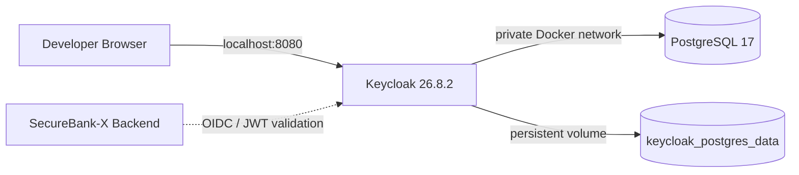

# SecureBank-X | Identity & Access Management

A local development deployment of **Keycloak 26.8.2** with **PostgreSQL 17** for the SecureBank-X banking application.

> **Environment:** local security lab / development. This Compose profile uses Keycloak `start-dev` and HTTP. It is not a production deployment.

## What this repository provides

- Keycloak identity provider using OpenID Connect (OIDC).
- PostgreSQL-backed persistent Keycloak configuration.
- Local-only port binding (`127.0.0.1:8080`).
- Environment-based bootstrap credentials.
- Setup, health-check, stop, and database-backup scripts.
- Security baseline and realm configuration notes.
- GitHub Actions Compose syntax validation.

## Architecture



## Requirements

- Kali Linux / Debian-based Linux
- Docker Engine
- Docker Compose v2 (`docker compose`)
- `curl` and `openssl`

## Quick deployment

```bash
git clone https://github.com/riad67/securebank-x-iam.git
cd securebank-x-iam
chmod +x scripts/*.sh
./scripts/setup.sh
```

Open the Keycloak administration console:

- Admin console: http://localhost:8080/admin/
- OIDC discovery: http://localhost:8080/realms/securebank/.well-known/openid-configuration

The setup script creates `.env` with generated credentials if it does not already exist. Read the terminal output and retain the generated credentials securely.

## Initial Keycloak configuration

1. Sign in to the admin console using the bootstrap admin credentials in `.env`.
2. Create a realm named `securebank` (do not use `master` for banking application users).
3. Create the application clients according to `docs/realm-and-client-baseline.md`.
4. Configure roles, groups, MFA, brute-force protection, and session settings.
5. Create test users with non-production data.
6. Verify OIDC discovery and JWKS endpoints using `scripts/health-check.sh`.

## Useful commands

```bash
# Start / apply Compose configuration
docker compose up -d

# Show container status
docker compose ps

# Follow Keycloak logs
docker compose logs -f keycloak

# Check OIDC discovery and local endpoint
./scripts/health-check.sh

# Back up the Keycloak PostgreSQL database
./scripts/backup.sh

# Stop containers but preserve the database volume
./scripts/stop.sh

# Start again
docker compose up -d
```

**Warning:** `docker compose down -v` deletes the persistent database volume. Do not run it unless you intentionally want to erase the Keycloak database.

## Repository structure

```text
securebank-x-iam/
├── .github/workflows/compose-validation.yml
├── config/realm/README.md
├── docs/
│   ├── architecture.md
│   ├── realm-and-client-baseline.md
│   ├── screenshots.md
│   └── security-baseline.md
├── screenshots/
│   └── README.md
├── scripts/
│   ├── backup.sh
│   ├── health-check.sh
│   ├── setup.sh
│   └── stop.sh
├── .env.example
├── .gitignore
├── docker-compose.yml
├── LICENSE
└── README.md
```

## Security notes

- Never commit `.env`, exported realm files, database backups, access tokens, or client secrets.
- Keep the admin account separate from application users.
- Use Authorization Code flow; use PKCE `S256` for public clients.
- Keep confidential-client secrets on the backend only.
- Validate JWT signature, issuer, audience, expiry, and required roles/scopes in the API.
- Enforce account ownership and transaction authorization in the banking backend; Keycloak roles alone are not sufficient.
- Before any shared-network or production deployment, configure HTTPS, a stable hostname, trusted proxy settings, restrictive firewall rules, backups, and production-mode Keycloak settings.

## Screenshots

Add sanitized screenshots under `screenshots/`. See `docs/screenshots.md` for the recommended capture list. Hide passwords, client secrets, personal data, tokens, and internal IPs before committing.

## License

MIT. See [LICENSE](LICENSE).
