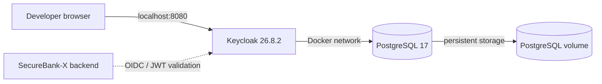

# SecureBank-X | Identity and Access Management

A local identity and access management lab for the SecureBank-X banking application, built with **Keycloak 26.8.2** and **PostgreSQL 17**. Keycloak provides OpenID Connect (OIDC) authentication, while PostgreSQL persists its configuration and user data.

> **Development only:** This configuration runs Keycloak with `start-dev` over HTTP and binds it to localhost. It is intended for a local security lab, not production or shared-network deployment.

## Demo Video

https://github.com/user-attachments/assets/a52a308b-d70e-4843-8cbb-523de0fe5856

## Features

- Keycloak identity provider with OIDC support.
- PostgreSQL-backed persistent storage on a Docker named volume.
- Keycloak exposed only on `127.0.0.1:8080`.
- Generated bootstrap credentials and database passwords for local setup.
- Scripts for setup, health checks, database backups, and shutdown.
- Security and realm configuration guidance, plus a GitHub Actions Compose validation workflow.

## Architecture



The backend connection is an integration target; this repository starts Keycloak and PostgreSQL only. The `securebank` realm and application clients must be configured manually.

## Prerequisites

- Kali Linux or another Debian-based Linux distribution.
- Docker Engine and Docker Compose v2 (`docker compose`).
- Bash, `curl`, `openssl`, and Python 3 (used by the health-check script).
- Git and permission to run Docker commands.
- An available local port `8080` and internet access to pull the container images.

### Install Docker on Debian or Kali Linux

If Docker and Compose are already installed, skip this section. On a Debian-based system, install the packages available from your distribution's configured repositories:

```bash
sudo apt update
sudo apt install -y docker.io docker-compose-plugin git curl openssl python3
sudo systemctl enable --now docker
```

Package availability varies by distribution and repository configuration. If `docker-compose-plugin` is unavailable, follow Docker's official [Docker Engine installation instructions](https://docs.docker.com/engine/install/) for your distribution and install the Compose plugin.

Verify the installation:

```bash
docker --version
docker compose version
sudo docker info
```

The commands below assume your user can access the Docker daemon. If necessary, run Docker commands and the scripts with appropriate privileges. Docker group membership grants root-equivalent privileges; see [Docker's post-installation guidance](https://docs.docker.com/engine/install/linux-postinstall/).

## Quick start

```bash
git clone https://github.com/riad67/securebank-x-iam.git
cd securebank-x-iam
chmod +x scripts/*.sh
./scripts/setup.sh
```

On first run, the setup script creates `.env` from `.env.example`, generates passwords, restricts the file permissions, validates the Compose configuration, pulls the images, and starts the services. It prints the bootstrap admin password; save it securely. An existing `.env` is left unchanged.

Allow Keycloak time to start, then open the [admin console](http://localhost:8080/admin/) and sign in with the bootstrap credentials in `.env`. The script does **not** create the application realm.

### Configure the realm

1. In the admin console, create a realm named `securebank`. Do not use the `master` realm for application users.
2. Create application clients using the [realm and client baseline](docs/realm-and-client-baseline.md).
3. Configure roles, groups, MFA, brute-force protection, and sessions for your lab.
4. Create test users using non-production data.
5. Run the health check after creating the realm:

   ```bash
   ./scripts/health-check.sh
   ```

The check verifies that Keycloak responds and that the `securebank` OIDC discovery endpoint returns valid JSON. It does not independently validate JWKS or token signatures.

| Local endpoint | URL |
| --- | --- |
| Administration console | http://localhost:8080/admin/ |
| OIDC discovery (after realm creation) | http://localhost:8080/realms/securebank/.well-known/openid-configuration |

## Docker and maintenance commands

Run these commands from the repository root:

```bash
# Validate the resolved Compose configuration
docker compose config --quiet

# Pull images and start or update containers
docker compose pull
docker compose up -d

# Inspect services and follow logs
docker compose ps
docker compose logs -f keycloak
docker compose logs -f postgres

# Check Keycloak and the securebank OIDC discovery endpoint
./scripts/health-check.sh

# Create a PostgreSQL backup in backups/ (database container must be running)
./scripts/backup.sh

# Stop and remove containers while preserving the database volume
./scripts/stop.sh

# Start the services again
docker compose up -d
```

If `make` is installed, equivalent shortcuts include `make up`, `make down`, `make ps`, `make logs`, `make health`, `make backup`, and `make config`.

Backups contain identity configuration and user records. Store them securely and keep them out of Git. The named PostgreSQL volume survives `docker compose down` and `./scripts/stop.sh`.

> **Data loss:** `docker compose down -v` removes the database volume and its contents. Use it only when you intend to erase the local database.

## Troubleshooting

- **Keycloak is still starting:** Check `docker compose ps` and `docker compose logs -f keycloak`. PostgreSQL must become healthy before Keycloak starts.
- **Health check fails at OIDC discovery:** Confirm the `securebank` realm exists and Keycloak has finished starting. The realm is not created by the setup script.
- **Port 8080 is in use:** Stop the conflicting service or change the host port in `docker-compose.yml`; if you change it, also adjust the URLs used for access and health checks. Set `KEYCLOAK_URL` when running the health check, for example `KEYCLOAK_URL=http://localhost:8081 ./scripts/health-check.sh`.
- **Docker permission denied:** Check Docker daemon access for your user, or run the relevant command with appropriate privileges.
- **Existing credentials are not regenerated:** Setup leaves an existing `.env` unchanged. Changing bootstrap environment variables does not necessarily reset an existing Keycloak administrator or an already initialized PostgreSQL database.

## Repository structure

```text
securebank-x-iam/
├── .github/workflows/compose-validation.yml
├── config/realm/README.md
├── docs/
│   ├── architecture.md
│   ├── realm-and-client-baseline.md
│   ├── screenshots.md
│   └── security-baseline.md
├── screenshots/
├── scripts/
│   ├── backup.sh
│   ├── health-check.sh
│   ├── setup.sh
│   └── stop.sh
├── .env.example
├── docker-compose.yml
├── Makefile
├── LICENSE
└── README.md
```

## Security notes

- Never commit `.env`, database backups, exported realm files, access tokens, or client secrets.
- Keep administrator accounts separate from application users; use only test data in this lab.
- Use Authorization Code flow and PKCE `S256` for public clients; keep confidential-client secrets on the backend.
- Validate JWT signature, issuer, audience, expiry, and required roles or scopes in the API.
- Enforce account ownership and transaction authorization in the banking backend; Keycloak roles alone are not sufficient.
- Before shared-network or production use, configure HTTPS, a stable hostname, trusted proxy settings, firewall rules, backups, and production-mode Keycloak settings. Review the [security baseline](docs/security-baseline.md).

## Screenshots

The repository includes screenshots of the local Keycloak and Docker setup:

| View | Screenshot |
| --- | --- |
| Keycloak administration console | [Open](screenshots/01-keycloak-admin-console.png) |
| SecureBank realm | [Open](screenshots/02-securebank-realm.png) |
| OIDC client settings | [Open](screenshots/03-oidc-client-settings.png) |
| Realm roles and groups | [Roles](screenshots/04-realm-roles.png) · [Groups](screenshots/05-user-groups.png) |
| Authentication and protection | [MFA](screenshots/06-mfa-authentication.png) · [Brute-force protection](screenshots/07-brute-force-protection.png) |
| Service and OIDC checks | [Docker Compose status](screenshots/08-docker-compose-status.png) · [OIDC discovery](screenshots/09-oidc-discovery.png) |

See the [screenshot guide](docs/screenshots.md) for capture and sanitization guidance.

## License

[MIT](LICENSE).
